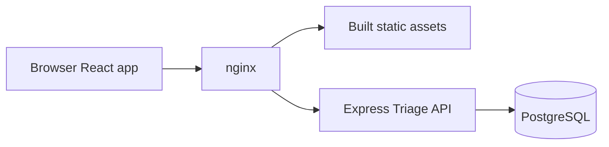

# Triage Web

[](https://github.com/SiyaCodesStuff/triage-web/actions/workflows/ci.yml)

A support-ticket workspace for customers, agents, and administrators. Customers
track their issues, agents move the queue forward, and administrators manage
access—all in a responsive React app backed by the [Triage API](https://github.com/SiyaCodesStuff/triage-api).

## Screenshots

Screenshots are pending. These placeholders describe the views to capture without
linking to image files that do not exist yet.

| View                | Screenshot placeholder                             |
| ------------------- | -------------------------------------------------- |
| Ticket queue        | Light theme, search, filters, and pagination       |
| Ticket detail       | Dark theme, status, assignee, and comment thread   |
| User administration | Role selection and confirmation dialog             |
| Mobile              | Navigation and ticket content at a narrow viewport |

## Features by role

The API enforces permissions; hiding or disabling controls is an additional UI aid.

| Role                    | Available features                                                                                                                         |
| ----------------------- | ------------------------------------------------------------------------------------------------------------------------------------------ |
| USER                    | Register, log in, log out, create and view own tickets, search/filter/sort the ticket list, and edit title/description on own OPEN tickets |
| AGENT                   | View the shared ticket queue, use staff assignee filters, edit ticket content, and change priority, staff assignee, and status             |
| ADMIN                   | Staff capabilities plus confirmed ticket deletion and searchable, paginated user administration with confirmed role changes                |
| All authenticated roles | Paginated comments on accessible tickets, add comments while a ticket is not CLOSED, and delete own comments                               |
| ADMIN comment override  | Delete any comment on an accessible ticket, including a CLOSED ticket                                                                      |

Staff status controls offer only valid next states: OPEN to IN_PROGRESS,
IN_PROGRESS to RESOLVED, and RESOLVED to OPEN or CLOSED. CLOSED has no next state.
Assignees must be staff. Administrators cannot demote themselves through the UI;
the API also rejects self-demotion. Role changes take effect on the next API
request because authorization uses the current database role.

The app includes loading skeletons, empty/error states with retry, inline form
errors, conflict feedback, toasts, a 404 page, a top-level error boundary, and
route-level lazy loading. Routes include `/login`, `/register`, `/tickets`,
`/tickets/new`, `/tickets/:id`, `/tickets/:id/edit`, and `/admin/users`.

## Stack

| Area                     | Technology                                                   |
| ------------------------ | ------------------------------------------------------------ |
| Runtime and build        | Node.js 24, npm, Vite                                        |
| Application              | React 19, strict TypeScript, React Router                    |
| Server state             | TanStack Query                                               |
| Forms                    | React Hook Form, Zod                                         |
| UI                       | Tailwind CSS 4, shadcn/ui, Radix UI, Lucide, Sonner          |
| API contract             | OpenAPI, openapi-typescript, typed fetch client              |
| Unit and component tests | Vitest, Testing Library, jsdom, MSW, vitest-axe, V8 coverage |
| Browser tests            | Playwright with Chromium against the real API and PostgreSQL |
| Tooling and delivery     | ESLint, Prettier, GitHub Actions, Docker, nginx              |

## Architecture



In the production container, nginx serves the SPA and proxies `/api/v1` to the
API, preserving the path, query, cookies, and CSRF header. Browser requests use
one origin. For local development, Vite provides the equivalent proxy to
`http://localhost:3000`; nginx is not required. The database is accessed by the
API only.

## Authentication and refresh

1. Register or log in through `/api/v1/auth/register` or `/api/v1/auth/login`.
   The API returns the public user in a `data` envelope and sets HttpOnly
   `triage_access` and `triage_refresh` cookies. No token is returned for the
   frontend to store.
2. `AuthProvider` loads the current user through `GET /api/v1/users/me` using
   TanStack Query. Protected routes preserve the requested destination for
   redirect after login; unsafe external return destinations are rejected.
3. The shared client sends `credentials: 'include'`. Every unsafe request sends
   the API's fixed `X-CSRF-Protection: 1` marker, including login and registration.
   This is not a secret token and does not protect against XSS.
4. A protected request receiving 401 attempts one refresh. Concurrent requests
   share one in-flight refresh operation per client instance. Successful refresh
   rotates cookies and retries each original request once. Auth endpoint errors
   do not recursively refresh.
5. Failed refresh or another 401 clears cached auth/private data and sends a
   protected visitor to `/login`. The optional session probe lets anonymous
   visitors remain on public auth pages. Logout revokes the refresh session,
   clears cookies through the API, and clears private query data.

Cookies use `SameSite=Strict` and are `Secure` in production, which requires
HTTPS. The API also supports bearer access credentials for other clients; this
SPA uses cookies. No authentication tokens are stored in localStorage or
sessionStorage. A saved theme preference may use localStorage.

Refresh reuse detection revokes all refresh sessions for that user. Already
issued access JWTs remain valid until expiry after logout or refresh revocation;
current database roles still govern authorization on every protected request.
Cross-tab refresh is not coordinated by the client's in-flight promise.

API failures use an `error` envelope containing string `code` and `message`
fields and optional `details`. The client exposes
these as `ApiError` with `status`, `code`, `message`, and `details`. Success
responses retain their documented `data` envelope and pagination metadata.
See [API authentication documentation](../triage-api/docs/auth.md) and the
running [OpenAPI specification](http://localhost:3000/openapi.json) for the contract.

## Local setup

Use Linux Node 24 inside WSL2, not a Windows Node/npm installation on a WSL path.
Keep sibling checkouts at `projects/triage-web` and `projects/triage-api`.

First prepare the API using its [setup instructions](../triage-api/README.md).
It needs PostgreSQL, its backend-only environment configuration, and migrations.
For an already configured API checkout, run in a separate terminal:

```sh
cd ~/projects/triage-api
nvm use 24
npm ci
npm run db:up
npm run db:migrate
npm run dev
```

Keep this process running. Verify readiness and the spec before using the SPA:

```sh
curl -f http://localhost:3000/ready
curl -f http://localhost:3000/openapi.json
```

Then start the frontend in another terminal:

```sh
cd ~/projects/triage-web
nvm use
npm ci
npm run dev
```

Open the URL Vite prints, normally `http://localhost:5173`. Register a USER through
the UI. An ADMIN must be seeded in the API using its documented `ADMIN_EMAIL`
and `ADMIN_PASSWORD` settings and `npm run db:seed`; there is no built-in frontend
admin password. API seeding does not reset an existing account's password.

`VITE_API_BASE_PATH` defaults to `/api/v1`, as documented in [.env.example](.env.example).
No frontend environment file is needed for the default. To override the public
path, use `VITE_API_BASE_PATH=/your/api npm run dev` and ensure the API serves that
path. Use a leading slash with no trailing slash. Never put secrets, database
URLs, passwords, or JWT keys in the frontend or any `VITE_` variable.

## Scripts

| Command                 | Purpose                                                         |
| ----------------------- | --------------------------------------------------------------- |
| `npm run dev`           | Start Vite with the API proxy                                   |
| `npm run build`         | Typecheck and generate `dist`                                   |
| `npm run preview`       | Preview the built SPA locally; inherits the Vite API proxy      |
| `npm run lint`          | Run ESLint with zero warnings allowed                           |
| `npm run typecheck`     | Check strict TypeScript without emitting files                  |
| `npm test`              | Run unit and component tests once                               |
| `npm run test:coverage` | Run Vitest with V8 coverage and an 80% aggregate line threshold |
| `npm run e2e`           | Run opt-in Playwright tests against the real API/database       |
| `npm run api:types`     | Generate and format `src/api/schema.d.ts` from the running API  |
| `npm run format`        | Format project files with Prettier                              |

## Testing and CI

Unit and component tests use MSW rather than a live API. Shared provider rendering,
typed user factories, and baseline handlers live in `src/test`. Shell configuration
tests use POSIX `sh` and `envsubst` from gettext, available in the Linux test setup.

```sh
npm run typecheck
npm run lint
npm test
npm run test:coverage
npm run build
```

On memory-constrained WSL hosts, run `npm test -- --maxWorkers=1` and
`npm run test:coverage -- --maxWorkers=1`. Avoid running browser tests and the unit
suite concurrently. Coverage reports include the per-file terminal table,
`coverage/index.html`, and `coverage/coverage-summary.json`. Tests/helpers,
generated declarations, type-only API adapters, and generated shadcn primitives
are excluded; application files otherwise count even when unvisited.

Playwright covers registration/login, ticket creation and URL filters, agent
status changes, comments, another USER receiving 404, and admin role changes with
immediate access revocation. Follow [e2e/README.md](e2e/README.md) to start the
Compose database, migrate a disposable test database, seed an admin, install
Chromium, and provide Node-only test credentials. The runner builds and previews
the frontend on port 4173; you must start the API separately. Unique emails make
runs repeatable, but fixture users remain because the API has no user-delete
endpoint. Auth rate limits still apply.

Default [CI](.github/workflows/ci.yml) runs `npm ci`, lint, typecheck, unit coverage,
and build with Node from `.nvmrc` and npm caching. It does not run Playwright.
The separate [manual E2E workflow](.github/workflows/e2e.yml) starts disposable
PostgreSQL and the pinned API revision, migrates/seeds it, and runs Chromium.
See the E2E guide for manual dispatch details.

## Accessibility

- A skip link, semantic landmarks, labelled controls, native table captions and
  headers, visible focus rings, and keyboard-scrollable table regions.
- Route changes focus main content and announce the new page. Lazy-route loading,
  async results, and toasts use polite announcements.
- Confirmation dialogs manage/trap focus, support Escape while idle, and return
  focus after closing. Form errors are associated with their fields.
- Light/dark themes follow the system setting by default. A CSP-hashed bootstrap
  applies the theme before paint; the React provider handles later changes.
- `vitest-axe` checks key pages/dialogs, with separate contrast checks for theme
  tokens. jsdom cannot evaluate rendered color contrast, so axe's contrast rule
  is disabled there. These checks do not replace manual keyboard, screen-reader,
  zoom, forced-colors, and browser contrast testing.

## Docker

### Pull a published image

The [publish workflow](.github/workflows/publish-image.yml) runs on pushed `v*`
tags and requires a stable release tag in `vMAJOR.MINOR.PATCH` format. For example,
`v1.2.3` builds the root Dockerfile and pushes `1.2.3`, `1.2`, and `latest` to
`ghcr.io/<owner>/<repo>`, with the owner and repository lowercased. The latter
two tags move to the most recently published release, including when publishing
an older release line. Prerelease and malformed tags fail before publishing.

After a successful publish, pull the desired tag (replace `1.2.3` with a published
version; adjust the owner/repository for a fork):

```sh
docker pull ghcr.io/siyacodesstuff/triage-web:1.2.3
# Alternatively, track a release line or the most recently published release:
docker pull ghcr.io/siyacodesstuff/triage-web:1.2
docker pull ghcr.io/siyacodesstuff/triage-web:latest
```

Anonymous pulls require the GHCR package visibility to be public. For a private
package, authenticate locally with an account authorized to read that package.
Publishing uses only the built-in `GITHUB_TOKEN`, with `contents: read` and
`packages: write`; no additional repository secrets are needed. The workflow
uses pinned action commits, GitHub Actions layer caching, and OCI source,
version, and MIT licence labels.

Published images use the default baked API path `/api/v1`. Set `API_UPSTREAM`
at startup as described below; the container listens on port 8080. A custom
public API path requires building your own image with `VITE_API_BASE_PATH`.

### Build and run locally

The multi-stage image builds with Node 24 and serves static output with nginx as
UID/GID 101 on container port 8080. The measured image size is **91,008,401 bytes
(91.0 MB or 86.8 MiB)** for the previously verified local build; architecture,
base-image updates, and future builds can change it.

For an API running directly in WSL, keep the API running, then use:

```sh
docker build -t triage-web:local .
docker run --rm --name triage-web-local -p 8080:8080 --read-only \
  --tmpfs /tmp:rw,noexec,nosuid,size=64m \
  --add-host host.docker.internal:host-gateway \
  -e API_UPSTREAM=http://host.docker.internal:3000 triage-web:local
```

Open `http://localhost:8080`. The API must listen on an interface reachable from
Docker. For an API container, attach both containers to the same existing network
and set `API_UPSTREAM` to its service origin, such as `http://triage-api:3000`.
Do not use container `localhost` for an API outside that container, or assume the
Docker bridge gateway is the address of a WSL-hosted API.

`API_UPSTREAM` is required at startup and accepts only an HTTP(S) origin without
credentials, path, query, or trailing slash. DNS is resolved when nginx starts;
restart the frontend after an upstream address change. HTTPS upstream certificates
are verified. To change the public API path, build with
`--build-arg VITE_API_BASE_PATH=/your/api`; the frontend and nginx receive the
same baked path. `API_UPSTREAM` changes the backend address, not that path.

nginx provides SPA fallback, a one-year immutable cache for successful hashed
assets, `no-store` for HTML/API responses, and security headers compatible with
the generated script CSP. Missing `/assets/` files return 404. Configuration,
PID, and temporary files use `/tmp`, allowing a read-only root filesystem.
`.dockerignore` excludes `.env*` files, dependencies, and local build/test artifacts.
Terminate production HTTPS and configure HSTS at the ingress.

Useful checks and recovery commands:

```sh
docker image inspect triage-web:local --format '{{.Size}}'
docker logs --tail 50 triage-web-local
docker stop triage-web-local
```

A 502 means the proxy did not obtain a usable API response: check the container
log and API readiness first. An occupied host port can be avoided with
`-p 8081:8080`, opening `http://localhost:8081`. To free a port, identify its
container with `docker ps --filter publish=8080`, then stop only that container.

## Decisions and trade-offs

| Decision                                                  | Benefit                                                                        | Trade-off                                                                                                                         |
| --------------------------------------------------------- | ------------------------------------------------------------------------------ | --------------------------------------------------------------------------------------------------------------------------------- |
| HttpOnly cookies instead of token storage in localStorage | Browser scripts cannot read the auth cookies; the API owns rotation and logout | Requires cookie-aware same-site hosting, HTTPS in production, and CSRF protection; XSS can still issue authenticated requests     |
| URL-synced search, filters, sort, and pagination          | Shareable views, reload persistence, and working browser back/forward          | URL parsing and normalization add complexity; URLs expose filter/search terms in history and copied links                         |
| Generated OpenAPI types                                   | Client paths and request/response types track the API contract                 | Requires a running API and regeneration after contract changes; types do not validate JSON at runtime                             |
| TanStack Query cache                                      | Shared server state, mutation invalidation, previous results while paging      | Cached state needs deliberate invalidation and clearing on auth changes; 4xx requests and mutations are not automatically retried |
| Route-level lazy loading                                  | Smaller initial bundle with separate page chunks                               | First navigation to a page needs its chunk; Suspense and focus/announcement handling remain necessary                             |
| One in-flight refresh per client                          | Concurrent requests within a tab do not race cookie rotation                   | Separate tabs still need consideration because refresh reuse detection is enforced by the API                                     |

Run `npm run api:types` in **triage-web**, with the API on port 3000, after changing
its contract. Review and commit the generated declaration file; do not hand-edit
it. Keep backend secrets and database configuration in the API project.

## License

See [LICENSE](LICENSE).
